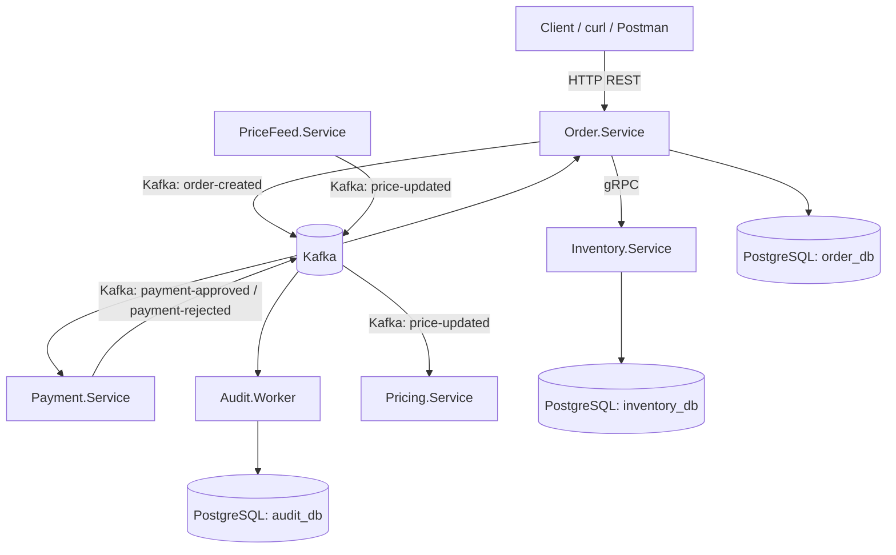

# MicroservicesLab

MicroservicesLab e um laboratorio pratico para estudar arquitetura de microservicos usando .NET, Go, PostgreSQL, Kafka, gRPC, Docker e Kubernetes.

O projeto foi construido em fases. A Parte I cobre os fundamentos de microservicos nas Fases 0-12 e esta concluida. A Parte II cobre sistemas distribuidos realtime nas Fases 13-22. A Parte III inicia a aplicacao front-end que funciona como painel de laboratorio para interagir com os servicos.

A expansao realtime foi iniciada na FASE 13 com `PriceFeed.Service` em Go. Na FASE 14, o fluxo passou a ser entregue para clientes externos via SSE. Depois dela, um mini-lab didatico adicionou gRPC Server Streaming direto entre `PriceFeed.Service` e `Pricing.Service`. Na FASE 15, o mesmo fluxo passou a ser publicado no Kafka como `PriceUpdated` no topico `price-updated`. Na FASE 16, `Pricing.Service` passou a consumir esse topico e manter o ultimo preco conhecido por simbolo em memoria.

## Arquitetura



## Tecnologias

- .NET 9 para `Order.Service`, `Inventory.Service`, `Audit.Worker` e `Shared.Contracts`.
- .NET 9 para `Pricing.Service`, com minimal API, consumer Kafka e estado derivado em memoria.
- Angular para `MicroservicesLab.App`, a aplicacao front-end do laboratorio.
- Go para `Payment.Service`.
- Go para `PriceFeed.Service`, onde a linguagem e usada de forma intencional para concorrencia, streaming, SSE, gRPC Server Streaming e cancelamento com `context.Context`.
- PostgreSQL com bancos independentes por servico.
- gRPC para a consulta de estoque entre Order e Inventory.
- Kafka para eventos de dominio e comunicacao assincrona.
- Docker Compose para o ambiente local inicial.
- Kubernetes para a etapa final do laboratorio.
- OpenTelemetry como base de observabilidade.

## Estrutura

```text
MicroservicesLab/
  src/
    frontend/
      MicroservicesLab.App/
    services/
      Order.Service/
      Inventory.Service/
      Payment.Service/
      PriceFeed.Service/
      Pricing.Service/
    workers/
      Audit.Worker/
    building-blocks/
      Shared.Contracts/
    protos/
  tests/
    Order.Service.Tests/
    Inventory.Service.Tests/
    Audit.Worker.Tests/
    Pricing.Service.Tests/
  infra/
    kafka/
    postgres/
    observability/
  k8s/
  scripts/
    k8s/
  docs/
    guides/
    labs/
  docker-compose.yml
  MicroservicesLab.sln
  README.md
```

## Quick Start

Docker Compose completo:

```powershell
docker compose up -d --build
docker compose ps
```

Aplicacao front-end no Docker Compose:

```text
http://localhost:4200
```

Execucao local do front-end para desenvolvimento:

```powershell
cd .\src\frontend\MicroservicesLab.App
pnpm install
pnpm start
```

O `pnpm start` usa `proxy.conf.json` para encaminhar `/api/order`, `/api/inventory`, `/api/pricefeed` e `/api/pricing` para as portas locais dos servicos, evitando CORS durante o desenvolvimento.

Kubernetes local:

```powershell
docker compose build inventory-service order-service payment-service audit-worker
kubectl apply -k k8s
kubectl get pods -n microservices-lab
```

## Documentacao

### Arquitetura

- [Architecture](docs/ARCHITECTURE.md)
- [Roadmap](docs/ROADMAP.md)
- [Progress](docs/PROGRESS.md)

### Guias Operacionais

- [Executando localmente](docs/guides/RUNNING-LOCALLY.md)
- [Kafka](docs/guides/KAFKA.md)
- [PostgreSQL](docs/guides/POSTGRESQL.md)
- [gRPC](docs/guides/GRPC.md)
- [Resiliencia](docs/guides/RESILIENCE.md)
- [Observabilidade](docs/guides/OBSERVABILITY.md)
- [Kubernetes](docs/guides/KUBERNETES.md)
- [Quick Reference](docs/guides/QUICK-REFERENCE.md)
- [Troubleshooting](docs/guides/TROUBLESHOOTING.md)

### Labs

- [Indice dos labs](docs/labs/README.md)

### Convencao Para Fases Futuras

Sempre que uma fase introduzir comandos, ferramentas ou procedimentos operacionais relevantes para estudo e operacao do laboratorio, avalie se os documentos em `docs/guides/` precisam ser atualizados.

Nao crie um documento novo para cada pequeno assunto. Prefira atualizar um guia existente quando fizer sentido.

Exemplos futuros:

- Docker e execucao local: atualizar ou expandir o guia de execucao local.
- Resiliencia: criar ou atualizar um guia apropriado.
- OpenTelemetry, Grafana e Jaeger: criar um guia de observabilidade.
- Kubernetes: criar um guia Kubernetes.
- Load e chaos testing: registrar nos labs ou em guia dedicado quando o assunto crescer.

## Fluxo Funcional Atual

1. Cliente cria um pedido em `POST /orders`.
2. `Order.Service` valida a entrada e consulta `Inventory.Service` via gRPC.
3. Havendo estoque, `Order.Service` persiste o pedido como `Pending`.
4. `Order.Service` publica `OrderCreated` no Kafka.
5. `Payment.Service` consome `OrderCreated` e simula pagamento.
6. `Payment.Service` publica `PaymentApproved` ou `PaymentRejected`.
7. `Order.Service` consome o evento de pagamento e atualiza o status do pedido.
8. `Audit.Worker` registra os principais eventos do sistema.

## Topicos Kafka Ativos

- `order-created`
- `payment-approved`
- `payment-rejected`
- `price-updated`

Na FASE 6, `Payment.Service` consome `order-created` e publica `payment-approved` ou `payment-rejected`. `Order.Service` consome esses eventos e atualiza o status do pedido.

Na FASE 7, `Audit.Worker` consome `order-created`, `payment-approved` e `payment-rejected`, registrando os envelopes reais no banco `audit_db`.

Na FASE 15, `PriceFeed.Service` publica `PriceUpdated` no topico `price-updated` quando `PRICE_KAFKA_ENABLED=true`.

Na FASE 16, `Pricing.Service` consome `price-updated` com o consumer group `pricing-service`, atualiza o ultimo preco conhecido por simbolo e expoe `GET /prices` e `GET /prices/{symbol}`.

## Roadmap

### Parte I - Microservices Fundamentals

| Fase | Descricao | Status |
| ---- | --------- | ------ |
| 0 | Estrutura | Concluido |
| 1 | Order Service | Concluido |
| 2 | Inventory Service | Concluido |
| 3 | gRPC | Concluido |
| 4 | Kafka producer | Concluido |
| 4.1 | Validacao Kafka real | Concluido |
| 5 | Payment Go | Concluido |
| 6 | Eventos pagamento | Concluido |
| 7 | Audit Worker | Concluido |
| 8 | Docker Compose | Concluido |
| 9 | Resiliencia | Concluido |
| 10 | Observabilidade | Concluido |
| 11 | Kubernetes | Concluido |
| 12 | Labs/documentacao | Concluido |

### Parte II - Realtime Distributed Systems

| Fase | Descricao | Status |
| ---- | --------- | ------ |
| 13 | PriceFeed.Service Go | Concluido |
| 14 | Realtime Delivery - SSE vs WebSocket | Concluido |
| 15 | Kafka PriceUpdated stream | Concluido |
| 16 | Pricing.Service .NET | Concluido |
| 17 | Concorrencia e backpressure | Pendente |
| 18 | Consumer scaling | Pendente |
| 19 | Multiplas instancias e partitioning | Pendente |
| 20 | Ingester/Processor | Pendente |
| 21 | Realtime observability | Pendente |
| 22 | Load e chaos testing | Pendente |

### Parte III - Application / Front-end

| Fase | Descricao | Status |
| ---- | --------- | ------ |
| 23 | Angular, estrutura inicial e Docker Compose | Concluido |
| 24 | Dashboard e navegacao | Concluido |
| 25 | Produtos e estoque | Concluido |
| 26 | Pedidos e pagamentos | Concluido |
| 27 | Precos realtime (SSE) | Concluido |
| 28 | Auditoria e observabilidade | Pendente |
| 29 | Integracao e validacao final | Pendente |

## Parte III: Aplicacao Front-end

A FASE 23 adiciona `MicroservicesLab.App`, uma aplicacao Angular standalone em `src/frontend/MicroservicesLab.App`. Ela prepara navegacao, configuracao de APIs e execucao em Docker Compose.

Na FASE 24, a rota `/dashboard` passa a exibir indicadores reais consumindo as APIs existentes:

- total de produtos via `/api/inventory/products`;
- total de pedidos via `/api/order/orders`;
- total de simbolos com preco via `/api/pricing/prices`;
- status dos servicos HTTP via endpoints `/health`.

Na FASE 25, a rota `/produtos` passa a consumir o `Inventory.Service` por meio do proxy do front-end:

- listagem real de produtos via `GET /api/inventory/products`;
- cadastro via `POST /api/inventory/products`;
- consulta de detalhes via `GET /api/inventory/products/{id}`;
- verificacao de disponibilidade via `POST /api/inventory/products/{id}/availability`.

A tela inclui estados de carregamento, vazio, erro, atualizacao manual e layout responsivo. Edicao, exclusao e reserva manual de estoque nao foram implementadas nesta fase.

Na FASE 26.2, a rota `/pedidos` passa a consumir o `Order.Service` por meio do proxy do front-end:

- listagem real de pedidos via `GET /api/order/orders`;
- criacao de pedidos via `POST /api/order/orders`;
- consulta de detalhes via `GET /api/order/orders/{id}`;
- acompanhamento de pagamento por polling enquanto o status estiver `Pending`.

A criacao de pedidos usa o comportamento atual do backend: o `Order.Service` consulta disponibilidade no `Inventory.Service`, mas nao reserva estoque automaticamente. A consistencia entre pedidos e estoque fica registrada como pendencia futura da FASE 29.1.

Na FASE 27, a rota `/precos` demonstra dois caminhos de dados em paralelo:

- snapshot REST via `GET /api/pricing/prices`, com os ultimos precos processados pelo `Pricing.Service` a partir do Kafka;
- stream SSE via `GET /api/pricefeed/prices/stream`, com atualizacoes diretas do `PriceFeed.Service`.

A tela exibe estado da conexao SSE, ultimos eventos recebidos, destaque visual quando um simbolo muda e atualizacao manual do snapshot REST. WebSocket e graficos complexos nao foram implementados nesta fase.

As telas de auditoria e observabilidade continuam como placeholders para as proximas fases.

Portas usadas pelo front-end:

```text
Angular dev server: http://localhost:4200
Docker Compose:     http://localhost:4200
Order API:          /api/order      -> Order.Service
Inventory API:      /api/inventory  -> Inventory.Service
PriceFeed API:      /api/pricefeed  -> PriceFeed.Service
Pricing API:        /api/pricing    -> Pricing.Service
```

## Parte II: Realtime Distributed Systems

A Parte II expande o laboratorio com `PriceFeed.Service`, um microservico Go voltado a fluxo continuo de precos, concorrencia, throughput, backpressure, particionamento, consumer lag, escalabilidade e comportamento sob carga/falhas.

Na FASE 13, o primeiro desenho conceitual foi implementado desacoplando a fonte de precos do fluxo principal:

```text
PriceProvider
      |
      +-- MockPriceProvider
      |
      +-- fonte externa futura
      |
      v
PriceFeed.Service
      |
      +-- ConsolePublisher
      |
      +-- Broadcaster
      |
      +-- KafkaPublisher
              |
              v
        Kafka: price-updated
              |
              +-- GET /prices/stream
              |       |
              |       v
              |      SSE
              |
              +-- gRPC StreamPrices
                      |
                      v
                 Pricing.Service
                    .NET
```

O `MockPriceProvider` inicial simula pequenas oscilacoes em multiplos simbolos, em vez de gerar valores aleatorios desconectados. O intervalo de geracao e configuravel para permitir experimentos futuros de throughput e backpressure.

Executar localmente:

```powershell
cd .\src\services\PriceFeed.Service
go run .
```

Frequencia maior para observacao local:

```powershell
$env:PRICE_UPDATE_INTERVAL = "100ms"
go run .
```

Use `Ctrl+C` para encerrar. O servico cancela o contexto, para os produtores, fecha o channel e encerra normalmente.

Na FASE 14, SSE foi escolhido para a entrega realtime porque o fluxo atual e unidirecional, do servidor para os clientes. WebSocket continua fora do escopo porque ainda nao existe requisito de comunicacao bidirecional continua.

Endpoints locais:

```text
GET /health
GET /prices/stream
```

Exemplo:

```powershell
curl http://localhost:8080/health
curl -N http://localhost:8080/prices/stream
```

Cada evento SSE usa `event: price-update` e envia `data` em JSON com `symbol`, `price` em centavos e `occurredAt`.

Depois da FASE 14, foi adicionado um mini-lab curto de gRPC Server Streaming. Ele reaproveita o `Broadcaster` do `PriceFeed.Service` e entrega o mesmo fluxo para um cliente .NET didatico em `Pricing.Service`, sem Kafka e sem persistencia:

```text
PriceFeed.Service
        Go
         |
         | gRPC Server Streaming
         v
   Pricing.Service
        .NET
```

Executar o cliente gRPC:

```powershell
cd .\src\services\Pricing.Service
$env:PRICE_FEED_GRPC_ADDRESS = "http://localhost:9090"
dotnet run
```

Lab: [Mini-lab Realtime gRPC](docs/labs/LAB-RT-GRPC-SERVER-STREAMING.md)

Na FASE 15, Kafka entra como broker entre produtor e consumidores futuros. O `PriceFeed.Service` publica eventos simples no topico `price-updated`, com 3 partitions e `symbol` como message key:

```json
{
  "symbol": "PETR4",
  "price": 3815,
  "occurredAt": "2026-09-29T14:30:00Z"
}
```

Kafka usa a key no particionamento. Eventos da mesma key devem ser direcionados consistentemente para uma partition pelo producer, e Kafka preserva ordering dentro da partition. Nao ha ordering global entre todas as partitions.

Executar com Kafka habilitado:

```powershell
cd .\src\services\PriceFeed.Service
$env:PRICE_KAFKA_ENABLED = "true"
$env:PRICE_KAFKA_BOOTSTRAP_SERVERS = "localhost:9092"
$env:PRICE_KAFKA_TOPIC = "price-updated"
go run .
```

Lab: [LAB 15 - Kafka PriceUpdated](docs/labs/LAB-15-kafka-price-updated.md)

Na FASE 16, a expansao demonstrou interoperabilidade completa Go -> Kafka -> .NET:

```text
PriceFeed.Service
        Go
         |
         | PriceUpdated
         v
       Kafka
         |
         v
   Pricing.Service
        .NET
```

O `Pricing.Service` transforma o stream de eventos em estado derivado atual:

```text
price-updated
      |
      v
KafkaPriceUpdatedConsumer
      |
      v
LatestPriceStore
      |
      +-- GET /prices
      +-- GET /prices/{symbol}
```

Executar localmente com Kafka:

```powershell
cd .\src\services\Pricing.Service
dotnet run
```

Endpoints:

```powershell
Invoke-RestMethod http://localhost:5000/health
Invoke-RestMethod http://localhost:5000/prices
Invoke-RestMethod http://localhost:5000/prices/PETR4
```

No Docker Compose, a API fica publicada em `http://localhost:5090`.

Lab: [LAB 16 - Pricing.Service Kafka](docs/labs/LAB-16-pricing-service-kafka.md)

Na FASE 15, `symbol` e a Kafka message key para estudar ordenacao por ativo dentro de partitions. Nas Fases 18 e 19, Kubernetes podera ser usado para subir replicas, mas o conceito principal sera a relacao entre consumer groups, partitions, ownership, rebalance e ordering.

## Comandos

Validar a solucao:

```powershell
dotnet build .\MicroservicesLab.sln
dotnet test .\MicroservicesLab.sln
```

Inspecionar ferramentas locais:

```powershell
dotnet --version
go version
docker --version
```

Rodar migrations do `Order.Service`:

```powershell
dotnet ef database update --project .\src\services\Order.Service\Order.Service.csproj --startup-project .\src\services\Order.Service\Order.Service.csproj
```

Rodar migrations do `Inventory.Service`:

```powershell
dotnet ef database update --project .\src\services\Inventory.Service\Inventory.Service.csproj --startup-project .\src\services\Inventory.Service\Inventory.Service.csproj
```

Rodar o `Order.Service`:

```powershell
dotnet run --project .\src\services\Order.Service\Order.Service.csproj
```

Rodar o `Inventory.Service`:

```powershell
dotnet run --project .\src\services\Inventory.Service\Inventory.Service.csproj
```

## Endpoints Disponiveis na FASE 1

Health checks:

```text
GET /health
GET /health/live
GET /health/ready
```

Pedidos:

```text
POST /orders
GET /orders/{id}
GET /orders
```

Exemplo:

```powershell
curl -X POST http://localhost:5074/orders `
  -H "Content-Type: application/json" `
  -d '{ "productId": "11111111-1111-1111-1111-111111111111", "quantity": 2 }'
```

Na FASE 1, o pedido e criado como `Pending` com `UnitPrice` e `TotalPrice` iguais a zero. A consulta de preco/estoque pertence ao `Inventory.Service` e sera integrada nas Fases 2 e 3.

## Endpoints Disponiveis na FASE 2

Health checks:

```text
GET /health
GET /health/live
GET /health/ready
```

Produtos:

```text
POST /products
GET /products/{id}
GET /products
POST /products/{id}/availability
POST /products/{id}/reserve
```

Exemplo:

```powershell
curl -X POST http://localhost:5276/products `
  -H "Content-Type: application/json" `
  -d '{ "name": "Notebook", "price": 3500.50, "availableQuantity": 10 }'
```

Na FASE 2, disponibilidade e reserva existem como operacoes HTTP administrativas/didaticas. Na FASE 3, essas mesmas capacidades serao expostas para `Order.Service` por gRPC.

## Integracao gRPC Disponivel na FASE 3

Contrato compartilhado:

```text
src/protos/inventory.proto
```

Operacoes gRPC:

```text
Inventory.CheckAvailability
Inventory.ReserveStock
```

Fluxo atual do `POST /orders`:

1. `Order.Service` valida `productId` e `quantity`.
2. `Order.Service` chama `Inventory.Service` via gRPC usando `CheckAvailability`.
3. Se o produto nao existir ou nao houver estoque suficiente, o pedido nao e persistido.
4. Se houver estoque, o pedido e persistido como `Pending` usando o `UnitPrice` retornado pelo Inventory.

Executar localmente em dois terminais:

```powershell
dotnet run --project .\src\services\Inventory.Service\Inventory.Service.csproj --launch-profile https
dotnet run --project .\src\services\Order.Service\Order.Service.csproj --launch-profile http
```

Exemplo de criacao de pedido depois de cadastrar um produto no Inventory:

```powershell
curl -X POST http://localhost:5074/orders `
  -H "Content-Type: application/json" `
  -d '{ "productId": "<PRODUCT_ID>", "quantity": 2 }'
```

## Kafka Disponivel na FASE 4

Contrato .NET compartilhado:

```text
src/building-blocks/Shared.Contracts
```

Topico publicado pelo `Order.Service`:

```text
order-created
```

Evento:

```json
{
  "eventId": "uuid",
  "eventType": "OrderCreated",
  "occurredAt": "timestamp",
  "correlationId": "trace-id-or-uuid",
  "data": {
    "orderId": "uuid",
    "productId": "uuid",
    "quantity": 2,
    "unitPrice": 25.50,
    "totalPrice": 51.00,
    "status": "Pending",
    "createdAt": "timestamp"
  }
}
```

Configurar Kafka no `Order.Service`:

```json
{
  "Kafka": {
    "BootstrapServers": "localhost:9092",
    "OrderCreatedTopic": "order-created"
  }
}
```

Criar topicos quando houver um container Kafka chamado `kafka`:

```powershell
.\infra\kafka\create-topics.ps1
```

O Docker Compose completo foi introduzido na FASE 8. O Compose isolado de Kafka continua existindo para estudo e debug especifico.

## Validacao Real do Kafka na FASE 4.1

A FASE 4.1 adiciona um Kafka isolado para validar o producer do `Order.Service`. Ela nao substitui a FASE 8.

```text
FASE 4.1: Kafka isolado para validacao e aprendizado.
FASE 8: toda a arquitetura executada via Docker Compose.
```

Subir Kafka local em modo KRaft:

```powershell
docker compose -f .\infra\kafka\docker-compose.kafka.yml up -d
```

Confirmar execucao:

```powershell
docker ps --filter "name=kafka"
docker inspect kafka --format "{{json .State.Health}}"
```

Criar o topico `order-created`:

```powershell
.\infra\kafka\create-topics.ps1
```

Se o PowerShell bloquear scripts:

```powershell
Set-ExecutionPolicy -Scope Process -ExecutionPolicy Bypass
.\infra\kafka\create-topics.ps1
```

Alternativa sem script:

```powershell
docker exec kafka /opt/kafka/bin/kafka-topics.sh --bootstrap-server localhost:9092 --create --if-not-exists --topic order-created --partitions 3 --replication-factor 1
```

Listar topicos:

```powershell
docker exec kafka /opt/kafka/bin/kafka-topics.sh --bootstrap-server localhost:9092 --list
```

Consumir `order-created` mostrando key e JSON:

```powershell
docker exec -it kafka /opt/kafka/bin/kafka-console-consumer.sh --bootstrap-server localhost:9092 --topic order-created --from-beginning --property print.key=true --property key.separator=" | "
```

Subir os servicos para validar o fluxo completo:

```powershell
dotnet run --project .\src\services\Inventory.Service\Inventory.Service.csproj --launch-profile https
dotnet run --project .\src\services\Order.Service\Order.Service.csproj --launch-profile http
```

Criar produto:

```powershell
curl -X POST http://localhost:5276/products `
  -H "Content-Type: application/json" `
  -d '{ "name": "Produto Kafka", "price": 100.00, "availableQuantity": 10 }'
```

Criar pedido usando o `id` retornado pelo produto:

```powershell
curl -X POST http://localhost:5074/orders `
  -H "Content-Type: application/json" `
  -d '{ "productId": "<PRODUCT_ID>", "quantity": 2 }'
```

O evento real deve aparecer no consumer com a key igual ao `OrderId`.

Validacao executada na FASE 4.1:

```text
Produto: 3eb208f9-41fc-42f8-961a-1412b0ec4541 - Notebook Gamer
Pedido: 93c03028-fa50-451c-94d6-def231caf1e3
Kafka key: 93c03028-fa50-451c-94d6-def231caf1e3
Topico: order-created
```

## Payment.Service Disponivel na FASE 5

`Payment.Service` e um consumidor Kafka em Go.

Nesta fase, ele consome `OrderCreated` do topico `order-created`, desserializa o envelope JSON produzido pelo `Order.Service`, valida o `eventType`, confirma a Kafka message key contra o `OrderId` e simula uma decisao de pagamento.

Na FASE 6, ele tambem publica `payment-approved` ou `payment-rejected`. A persistencia de `Payment` em banco proprio ainda nao foi implementada.

Executar o consumidor:

```powershell
cd .\src\services\Payment.Service
go run .\cmd\payment-service
```

Configuracao por variaveis de ambiente:

```text
KAFKA_BROKERS=localhost:9092
KAFKA_ORDER_CREATED_TOPIC=order-created
KAFKA_PAYMENT_APPROVED_TOPIC=payment-approved
KAFKA_PAYMENT_REJECTED_TOPIC=payment-rejected
KAFKA_GROUP_ID=payment-service
PAYMENT_MAX_AUTO_APPROVAL_AMOUNT=10000
```

Validar o modulo Go:

```powershell
cd .\src\services\Payment.Service
go test ./...
go build .\cmd\payment-service
```

Validacao real executada na FASE 5:

```text
Pedido: a3b3385d-7491-482a-bf18-5cf066a5fd21
Evento: 29f06cdc-5606-4448-b820-a973601ffe8c
Kafka key: a3b3385d-7491-482a-bf18-5cf066a5fd21
OrderId: a3b3385d-7491-482a-bf18-5cf066a5fd21
Resultado simulado: Approved
```

## Eventos de Pagamento Disponiveis na FASE 6

Fluxo assincrono validado:

```text
POST /orders
  -> Order.Service
  -> order-created
  -> Payment.Service
  -> payment-approved ou payment-rejected
  -> Order.Service
  -> status Paid ou PaymentRejected
```

Topicos ativos:

```text
order-created
payment-approved
payment-rejected
```

Criar/listar topicos:

```powershell
.\infra\kafka\create-topics.ps1
docker exec kafka /opt/kafka/bin/kafka-topics.sh --bootstrap-server localhost:9092 --list
```

Consumir evento aprovado:

```powershell
docker exec kafka /opt/kafka/bin/kafka-console-consumer.sh --bootstrap-server localhost:9092 --topic payment-approved --from-beginning --property print.key=true --property key.separator=" | "
```

Consumir evento rejeitado:

```powershell
docker exec kafka /opt/kafka/bin/kafka-console-consumer.sh --bootstrap-server localhost:9092 --topic payment-rejected --from-beginning --property print.key=true --property key.separator=" | "
```

Validacao real executada na FASE 6:

```text
PaymentApproved:
Pedido: 5ab80059-0f78-422d-bce1-817e505a3beb
Evento: b7ddb1aa-a82d-4ee8-9476-aaee2f91c2df
Kafka key: 5ab80059-0f78-422d-bce1-817e505a3beb
Status final do pedido: Paid

PaymentRejected:
Pedido: b4eb9ca0-8285-4e19-a897-f8c0ca8e53ca
Evento: 562eb5f4-2bf0-4b85-9cfb-4fd1bdfdf449
Kafka key: b4eb9ca0-8285-4e19-a897-f8c0ca8e53ca
Status final do pedido: PaymentRejected
```

## Audit.Worker Disponivel na FASE 7

`Audit.Worker` e um Worker Service .NET que consome eventos Kafka e grava historico em PostgreSQL.

Topicos consumidos:

```text
order-created
payment-approved
payment-rejected
```

Banco:

```text
Audit.Worker -> audit_db
Tabela: audit_events
```

Executar o worker:

```powershell
dotnet run --project .\src\workers\Audit.Worker\Audit.Worker.csproj
```

Aplicar migrations:

```powershell
dotnet ef database update --project .\src\workers\Audit.Worker\Audit.Worker.csproj --startup-project .\src\workers\Audit.Worker\Audit.Worker.csproj
```

Validacao real executada na FASE 7:

```text
Produto: 3eb208f9-41fc-42f8-961a-1412b0ec4541
Pedido: de3bb377-05ed-4e93-a7b8-97ab26747528
OrderCreated: ec01f81b-beba-4f90-aa20-f7f7c6a64521
PaymentApproved: 4ae0e42c-8cc1-4a82-ad60-a47bd1b902eb
Kafka key: de3bb377-05ed-4e93-a7b8-97ab26747528
Key igual ao OrderId: sim
Registros no audit_db: 2 para esse pedido
```

## Docker Compose Completo Disponivel na FASE 8

O ambiente completo atual sobe pela raiz do repositorio:

```powershell
docker compose up -d --build
```

Servicos no Compose:

```text
postgres
kafka
kafka-init
inventory-service
order-service
payment-service
audit-worker
otel-collector
jaeger
prometheus
grafana
```

Portas expostas no host:

```text
PostgreSQL: 5432
Kafka: 9092
Inventory.Service HTTP: 5276
Inventory.Service gRPC: 7242 -> container 8081
Order.Service HTTP: 5074
Jaeger: 16686
Prometheus: 9090
Grafana: 3000
OTLP gRPC: 4317
OTLP HTTP: 4318
```

O Compose usa volumes nomeados `postgres_data` e `kafka_data`. `docker compose down` preserva os dados; `docker compose down -v` apaga bancos, mensagens e offsets locais.

Na FASE 8, migrations EF Core sao aplicadas automaticamente pelos servicos .NET quando `Database__ApplyMigrations=true` esta definido no Compose. Os bancos `order_db`, `inventory_db` e `audit_db` sao criados por `infra/postgres/init-databases.sql` na primeira inicializacao do volume PostgreSQL.

Validacao real executada na FASE 8:

```text
Produto: 17aaa602-7840-4b42-abd4-7833e60efbe3 - Produto Compose Fase 8
Pedido: cbe21f22-9290-462f-8656-f8242894b56c
Status final: Paid
OrderCreated: ff816e92-9dbe-42e4-bcf0-7daff86ac712
PaymentApproved: d8c3bdd8-00d7-45ea-91c5-d165176befa0
Kafka key: cbe21f22-9290-462f-8656-f8242894b56c
Registros no audit_db: 2 para esse pedido
```

## Resiliencia Disponivel na FASE 9

`Order.Service` aplica timeout, retry limitado e circuit breaker na chamada gRPC para `Inventory.Service`.

Quando o Inventory esta indisponivel, `POST /orders` retorna `503 Service Unavailable`, nao persiste o pedido e nao publica `OrderCreated`. Quando o circuito esta aberto, chamadas seguintes falham rapido ate a janela de recuperacao.

O comportamento com Kafka indisponivel foi observado e documentado como limite atual: o pedido pode ser salvo como `Pending` antes da publicacao do evento falhar. A correcao desse ponto exige Outbox Pattern e fica para fase futura.

Guia:

```text
docs/guides/RESILIENCE.md
```

## Observabilidade Disponivel na FASE 10

O Compose inclui OpenTelemetry Collector, Jaeger, Prometheus e Grafana. O fluxo `POST /orders -> gRPC -> Kafka -> Payment -> Kafka -> Order/Audit` gera traces distribuidos, metricas e logs correlacionados por `TraceId`.

Guia:

```text
docs/guides/OBSERVABILITY.md
```

## Kubernetes Disponivel na FASE 11

O ambiente tambem pode rodar em Kubernetes local usando os manifests em `k8s/`.

```powershell
docker compose build inventory-service order-service payment-service audit-worker
kubectl apply -k k8s
kubectl get pods -n microservices-lab
```

Guia:

```text
docs/guides/KUBERNETES.md
```

## Labs e Fechamento Disponiveis na FASE 12

A FASE 12 consolidou a documentacao operacional da Parte I, criou labs repetiveis e registrou troubleshooting para Docker Compose, Kafka, PostgreSQL, resiliencia, observabilidade e Kubernetes.

Entrada principal:

```text
docs/labs/README.md
```

Guias de apoio:

```text
docs/guides/QUICK-REFERENCE.md
docs/guides/TROUBLESHOOTING.md
```

## Proximos Passos

A Parte I do MicroservicesLab esta concluida.

A Parte II foi iniciada com a FASE 13, ja possui entrega realtime via SSE, mini-lab gRPC, Kafka `price-updated` na FASE 15 e `Pricing.Service` consumindo o stream na FASE 16. O proximo passo possivel e a FASE 17: concorrencia e backpressure. Ela nao deve ser iniciada automaticamente. Use uma instrucao explicita quando quiser avancar:

```text
Avance para a FASE 17.
```
