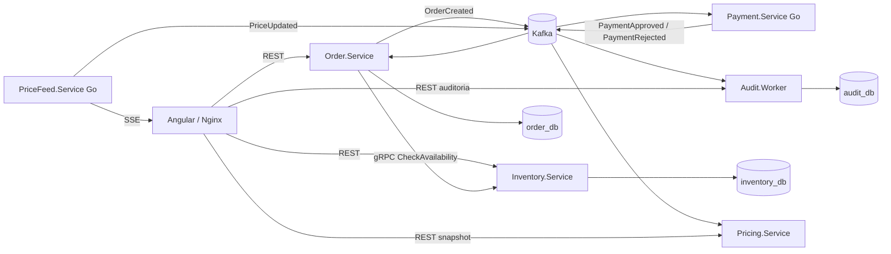

# MicroservicesLab

Laboratorio funcional de microsservicos com .NET 9, Go, PostgreSQL, Kafka, gRPC e Angular. A interface e um painel de estudo, nao um ERP ou sistema de producao.

Na branch `feature/part-3`, a Parte I (0-12), a Parte II ate a Fase 16 e a Parte III ate 29.3 estao concluidas. A Fase 30 (responsividade Angular) esta em execucao, com a implementacao e validacoes desta entrega registradas no [progresso](docs/PROGRESS.md#fase-30---responsividade-angular). Fases 17-22 e 31 (consistencia pedidos/estoque) permanecem pendentes. Veja o [roadmap oficial](docs/ROADMAP.md).

## Arquitetura resumida



O pedido consulta disponibilidade, mas **nao reserva estoque**. O pagamento e assincrono via Kafka; a interface acompanha o pedido por polling. Precos simulados chegam diretamente por SSE e, independentemente, pelo snapshot REST derivado do Kafka.

A [arquitetura detalhada](docs/ARCHITECTURE.md) descreve contratos, ownership, gRPC streaming opcional e observabilidade.

## Pre-requisitos

- Docker Desktop com engine Linux e Docker Compose para executar o ambiente.
- Desenvolvimento/testes locais: .NET SDK 9, Go conforme `go.mod` (1.26.3), Node.js 24 e pnpm conforme `package.json` (11.25.0).
- PowerShell nos exemplos. Kubernetes e opcional e possui [guia proprio](docs/guides/KUBERNETES.md); nao e necessario para usar o Angular.

As dependencias do front-end sao Angular 20.3, TypeScript e RxJS. Testes usam Vitest/jsdom. SDKs locais nao sao necessarios para o build inteiramente em Docker.

## Iniciar com Docker Compose

Na raiz do repositorio:

```powershell
docker compose config --quiet
docker compose up -d --build
docker compose ps --all
```

Acesse [MicroservicesLab](http://localhost:4200). Rotas: `/dashboard`, `/produtos`, `/pedidos`, `/precos`, `/auditoria` e `/observabilidade`.

`kafka-init` terminar em **Exited (0)** e esperado: ele cria os quatro topicos e encerra. PostgreSQL e Kafka usam volumes nomeados; nao apague volumes para solucionar falhas de inicializacao. Migrations existentes sao aplicadas pelo Compose; os bancos sao `order_db`, `inventory_db` e `audit_db`.

| Componente | Acesso pelo host |
| --- | --- |
| Angular / Nginx | [localhost:4200](http://localhost:4200) |
| Order REST | [localhost:5074/orders](http://localhost:5074/orders) |
| Inventory REST | [localhost:5276/products](http://localhost:5276/products) |
| Audit REST | [localhost:5288/audit-events](http://localhost:5288/audit-events) |
| PriceFeed SSE | [localhost:5080/prices/stream](http://localhost:5080/prices/stream) |
| Pricing REST | [localhost:5090/prices](http://localhost:5090/prices) |
| Grafana | [localhost:3000](http://localhost:3000), laboratorio: admin/admin |
| Prometheus | [localhost:9090](http://localhost:9090) |
| Jaeger | [localhost:16686](http://localhost:16686) |
| PostgreSQL / Kafka | `localhost:5432` / `localhost:9092` |
| gRPC Inventory / PriceFeed | `localhost:7242` / `localhost:19090` |

O Angular usa URLs relativas `/api/order`, `/api/inventory`, `/api/audit`, `/api/pricefeed` e `/api/pricing`. Nginx remove esses prefixos e encaminha para os servicos da rede Compose; nao ha API Gateway/BFF.

## Desenvolver o front-end

Com as APIs ativas, em um terminal separado:

```powershell
Set-Location .\src\frontend\MicroservicesLab.App
pnpm install --frozen-lockfile
pnpm start
```

O dev server tambem usa a porta 4200. Nao o execute nessa porta enquanto o frontend Docker estiver ativo; para coexistir, use `pnpm start --port 4201`.

Endpoints ficam em `src/environments`; `proxy.conf.json` aponta para as portas locais das APIs. Organizacao: `src/app/core/api` (clientes tipados), `src/app/pages` (telas standalone) e `app.routes.ts` (navegacao). Estrutura completa e execucao manual: [guia local](docs/guides/RUNNING-LOCALLY.md).

## Testes

.NET, a partir da raiz:

```powershell
dotnet build .\MicroservicesLab.sln
dotnet test .\MicroservicesLab.sln --no-build
docker compose config --quiet
```

Angular, a partir da raiz:

```powershell
Push-Location .\src\frontend\MicroservicesLab.App
pnpm test:ci
pnpm build
Pop-Location
```

Go, a partir da raiz:

```powershell
Push-Location .\src\services\Payment.Service
go test ./...
Pop-Location
Push-Location .\src\services\PriceFeed.Service
go test ./...
Pop-Location
```

Procedimentos e evidencias E2E: [testes integrados](docs/INTEGRATION_TESTS.md). O script cria registros reais; `-IncludeFailures` para servicos e deve ser executado somente de forma deliberada. Resultados em `.cache/` nao sao versionados.

## Limites conhecidos

- SaveChanges e publicacao Kafka nao sao atomicos: falha de publish pode deixar pedido Pending sem evento. Reserva, idempotencia e compensacao aguardam a Fase 31.
- Payment nao possui health HTTP nem persistencia propria. HTTP healthy e container running nao comprovam processamento Kafka.
- Pricing mantem estado em memoria; reinicio retoma offsets do grupo, nao reconstroi automaticamente um snapshot duravel.
- Nao ha garantia exactly-once, DLQ ou recuperacao automatica de todo erro fatal dos consumidores.
- SSE nao tem replay; os caminhos REST/Kafka e SSE podem divergir momentaneamente.
- Observabilidade instrumenta Order, Inventory, Payment e Audit. PriceFeed/Pricing nao possuem a instrumentacao OTLP dessa Parte I.
- Credenciais e portas sao para laboratorio local. Sem autenticacao/TLS; nao expor o Compose diretamente na internet.
- A Fase 30 adapta as seis telas de 360px a 1920px, com menu recolhivel ate 820px e scroll localizado nas tabelas/payload. Validacao em dispositivos fisicos permanece manual. A interrupcao Kafka foi omitida na Fase 29.2 por risco de inconsistencia.

Diagnosticos, severidades e pendencias: [revisao tecnica 29.3](docs/TECHNICAL_REVIEW.md).

## Documentacao

- [Roadmap](docs/ROADMAP.md), [Progresso](docs/PROGRESS.md), [Arquitetura](docs/ARCHITECTURE.md).
- [Execucao local](docs/guides/RUNNING-LOCALLY.md), [Troubleshooting](docs/guides/TROUBLESHOOTING.md), [Referencia rapida](docs/guides/QUICK-REFERENCE.md).
- [Kafka](docs/guides/KAFKA.md), [PostgreSQL](docs/guides/POSTGRESQL.md), [gRPC](docs/guides/GRPC.md), [Resiliencia](docs/guides/RESILIENCE.md).
- [Observabilidade](docs/guides/OBSERVABILITY.md), [Kubernetes](docs/guides/KUBERNETES.md), [Indice dos labs](docs/labs/README.md).
- [Lab Kafka PriceUpdated](docs/labs/LAB-15-kafka-price-updated.md), [Lab Pricing](docs/labs/LAB-16-pricing-service-kafka.md), [Mini-lab gRPC streaming](docs/labs/LAB-RT-GRPC-SERVER-STREAMING.md).

Historico por fase e evidencias anteriores ficam em PROGRESS e nos labs; README e o ponto de entrada operacional. Novos procedimentos devem atualizar os guias existentes, sem duplicar todo o historico aqui.
